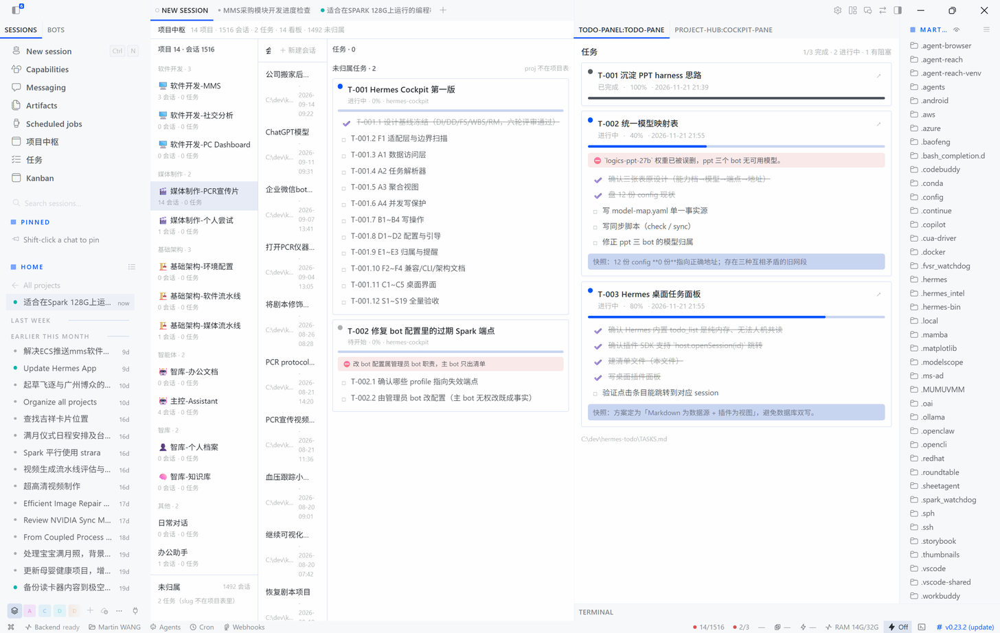

# Hermes Cockpit · 项目中枢

把 Hermes 桌面 App 里**四类互不相通的东西**聚合到一屏：**项目 / 会话 / 任务 / 看板**。

Hermes 本身有项目表（`projects.db`）、会话库（`state.db`）、任务清单（`TASKS.md`）、看板（`kanban.db`），
但这四者在界面上彼此看不见。结果是：**你记得「上周跟那个客户聊过」，却找不到是哪次会话；
任务写了，但不知道它挂在哪个项目下。**

这个插件把它们拼成三栏：**左选项目 → 中看会话 → 右看任务**，可点、可归类、可改。



---

## 它做什么

| 能力 | 说明 |
|---|---|
| **三栏聚合** | 左「分类 + 项目」· 中「会话」· 右「任务」，一个屏幕看完 |
| **会话归类** | 把游离会话手动挂到项目上（cwd 推得出来的自动挂，推不出来的由你点） |
| **任务读写** | 直接编辑 `TASKS.md`，支持子任务勾选、进度、阻塞标记 |
| **项目内新建会话** | 新会话的 `cwd` 锚到项目目录，不会又变成游离会话 |
| **看板只读聚合** | 按项目汇总看板卡片数，不写回看板 |
| **未归属兜底** | cwd 认不出、又没手标的会话/任务，单列出来，不会「人间蒸发」 |

## 它不做什么（硬边界）

这几条是设计约束，不是没做完：

- **不合并 / 不拆分会话。** Hermes 上游没有这两个 RPC，只有 `branch` / `save` / `compress`。
- **不改 `sessions.cwd`。** 上游有多个已知 bug，改了就丢会话。
- **不新建数据源。** `projects.db` / `state.db` / `kanban.db` 一律以 `mode=ro` 只读打开。
  唯一可写的是你自己的 `META.yaml`（会话归类）和 `TASKS.md`（任务）。
- **不自动归类。** 推测只给建议，执行必须你点头。

---

## 安装

前置：Hermes 桌面版 0.23.x，Windows / macOS。

```bash
git clone <this-repo> hermes-cockpit
cd hermes-cockpit

# 首次准备数据文件（这两个不入库，因为是个人数据）
cp META.example.yaml META.yaml
cp TASKS.example.md  TASKS.md

# 装到宿主 + 启用 + 自检
bash scripts/install.sh
```

`install.sh` 会做四件事，最后一步是自检（`tasks > 0` 且 `stamp` 非空才返回 0）：

1. 拷后端到 `<HERMES_HOME>/plugins/project-hub/`
2. 把 `plugin.yaml` 的 `data_dir` 改成本仓库绝对路径（源文件里是 `../../`，保持可移植）
3. 拷桌面插件到 `<HERMES_HOME>/desktop-plugins/project-hub/`
4. `hermes plugins enable project-hub` + 取数自检

**装完不用重启 App**：在 App 里按 `Ctrl+K`（macOS `Cmd+K`）→ 输入 `reload plugin` →
选 **Reload desktop plugins**。侧栏就会出现「项目中枢」。

> 首次打开会看到引导页，二选一：
> - **从零开始** — 只看插件安装之后的会话
> - **导入已有** — 全量视野（已有项目/会话多的话选这个）
>
> ⚠️ `setup.at` 写入后**永不改变**，选之前想清楚。

---

## 开发

```bash
# 后端 + 协议
python -m pytest -q

# 桌面插件：数据层与写操作契约（真跑后端取一次数）
node desktop-plugins/project-hub/__check.mjs

# 桌面插件：渲染树（三栏 / 引导态 / 分页 / 孤儿任务）
node desktop-plugins/project-hub/__render_check.mjs

# 适配层边界：宿主接触面只允许 host_adapter.py
python scripts/check_boundary.py
```

四条**必须各自裸跑**，不要拼进 `&&` 链再 `tail` —— 那样拿到的是 `tail` 的退出码，会假绿。

目录：

```
plugins/project-hub/          # Python 后端（挂到 /api/plugins/project-hub/）
  __init__.py                 # 插件注册入口（系统提示注入）
  _module_loader.py           # 按文件路径加载内部模块，避免同名冲突
  core/                       # 纯逻辑：任务解析、进度、注入、跑题检测
  dashboard/
    plugin_api.py             # FastAPI router（8 条路由）
    store.py                  # 聚合视图 overview()
    host_adapter.py           # ★ 唯一的宿主接触面
    fileio.py                 # mtime + 409 并发保护
    manifest.json             # dashboard 发现用
  plugin.yaml                 # CLI 插件体系用
desktop-plugins/project-hub/
  plugin.js                   # 单文件桌面插件（5 个注册点）
scripts/install.sh            # 安装 + 自检
scripts/check_boundary.py     # 边界校验
```

---

## 踩过的坑（写给改这个插件的人）

这几条都是实测踩出来的，每一条都曾让插件「看起来装好了，实际什么都不工作」。

### 1. 桌面插件取数不能用裸 `fetch`

打包版桌面 App 的页面是 `file:///…/app.asar.unpacked/dist/index.html`（没有 dev server），
裸 `fetch('/api/plugins/...')` 会被当成本地文件去找：

```
DevTools ▸ Network:  tasks   (failed) net::ERR_FILE_NOT_FOUND
```

而后端完全正常。正确通道是 Electron IPC：

```js
window.hermesDesktop.api({ path, method, body, priority: 'foreground' })
```

本插件把它包成 `apiFetch()`，返回 fetch Response 形状，上层错误分支不用改。

**排查口诀**：看到「读不到清单 / Failed to fetch」，先按 F12 看 Network。
出现 `ERR_FILE_NOT_FOUND` = 相对路径写法错了，别去查端口、鉴权、路由挂载。

### 2. 插件 id 必须四处一致

一个插件在四个地方有「名字」，任一不一致就会静默失效：

| 位置 | 字段 | 被谁用 |
|---|---|---|
| 目录名 | `plugins/<id>/` | 路由前缀 `/api/plugins/<id>` |
| `plugin.yaml` | `name` | `plugins.enabled` 白名单比对、CLI 启用 |
| `dashboard/manifest.json` | `name` | dashboard 插件发现 |
| `desktop-plugins/*/plugin.js` | `const ID` | 桌面注册、前端请求路径 |

不一致的典型症状：`hermes plugins list` 显示 enabled，但界面报
`404 {"detail":"Plugin not found"}`——因为挂载判定拿 `plugin['name']` 去查白名单，查不到就整条后端不挂。

### 3. 被 duplicate 冲突污染的 id 换名比重置快

如果同一个 id 曾经因为两个目录同名冲突加载失败过，之后即使文件完全正确、reload 多次，
入口也可能不再出现（错误记录不清）。这时**换一个新 id** 比修复状态省事得多。

### 4. 桌面侧重扫的触发条件

`runtime-loader.ts` 每 5 秒轮询一次，但**只在 `document.visibilityState === 'visible'` 时**；
`watchDirectory` 成功时完全走文件事件、不轮询。手动重扫只有一条可靠路径：
命令面板 → `Reload desktop plugins`。

---

## 兼容性

- 目标宿主：Hermes Desktop **0.23.x**
- 宿主版本变了，`dashboard/compat.yaml` 里声明的区间之外会**降级为只读**并在面板顶部横幅说明原因
- 全部宿主接触点集中在 `dashboard/host_adapter.py`，宿主 API 变动时只改这一个文件

## License

MIT
